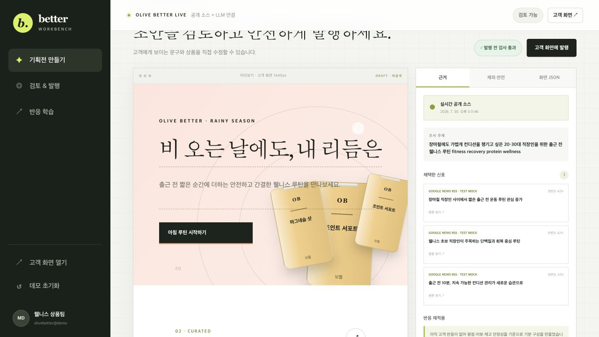
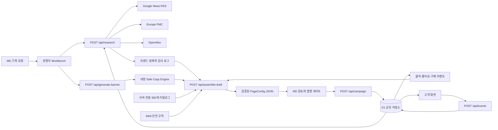
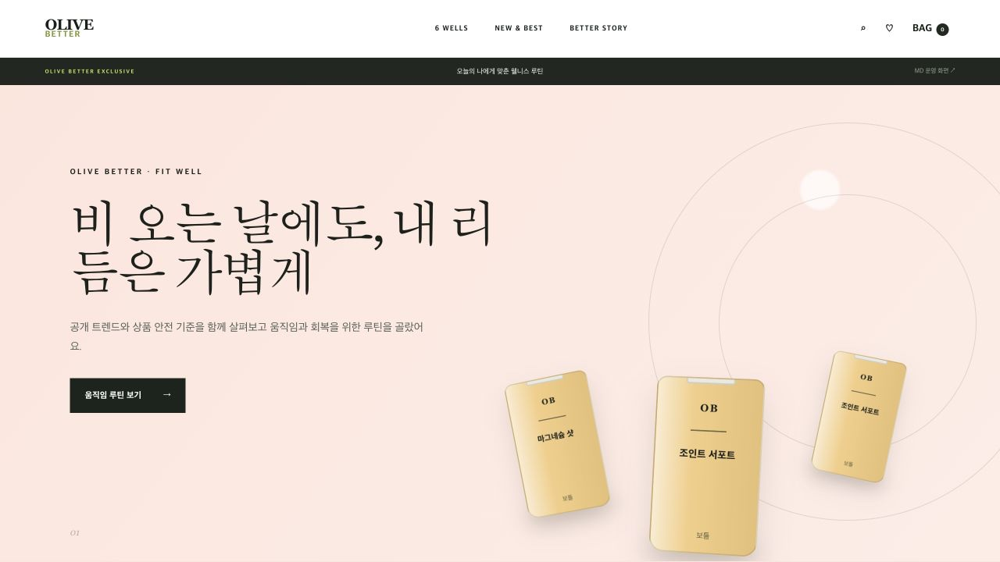
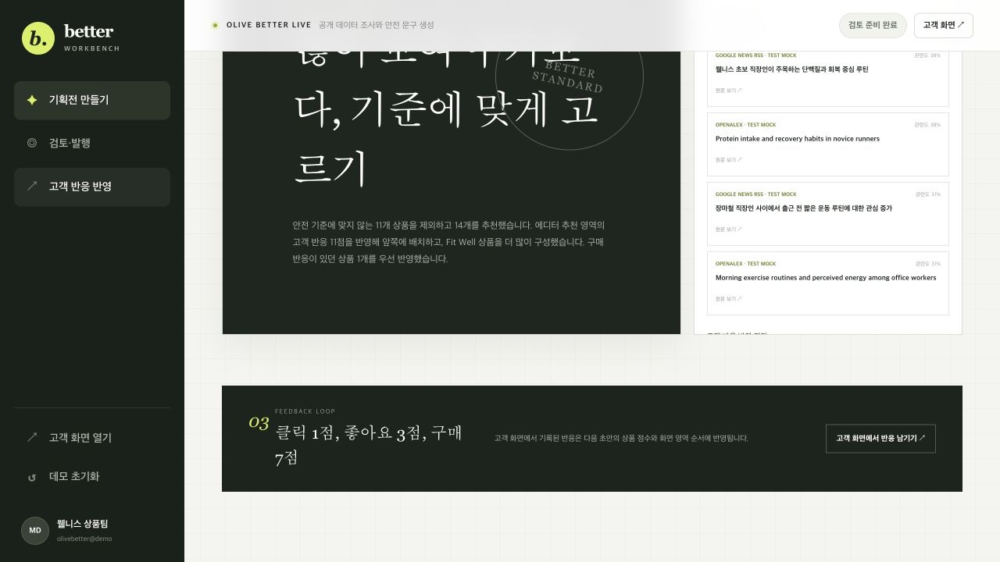

# Better Workbench

> 웰니스 MD의 기획 요청을 근거가 있는 상품 기획전으로 바꾸고, 검토와 발행, 고객 반응 반영까지 연결한 운영 도구

[라이브 데모](https://olive-better-workbench-2026.khyun97.chatgpt.site) · [고객 화면](https://olive-better-workbench-2026.khyun97.chatgpt.site/shop) · [AI 협업 기록](./AI_COLLABORATION.md)



2026 COFATHON의 올리브영 웰니스 기획 과제를 바탕으로, 공식 행사 종료 후 개인적으로 확장한 포트폴리오 프로젝트입니다. 올리브영의 실제 운영 서비스가 아니며 상품, 회원, 구매 데이터는 데모 또는 시뮬레이션입니다.

## 프로젝트 한눈에 보기

| 항목 | 내용 |
| --- | --- |
| 사용자 | 웰니스 상품 기획전을 만드는 MD |
| 해결하려는 문제 | 트렌드 조사, 상품 검증, 문구 안전 확인, 화면 구성, 발행이 서로 분리되어 반복 검토가 느려지는 문제 |
| 핵심 흐름 | 기획 요청 → 공개 트렌드 조사 → 자료 정제 → 상품 추천·검증 → JSON 화면 생성 → MD 검토·발행 → 고객 반응 반영 |
| 구현 상태 | 운영자 화면, 고객 화면, 서버 API, 추천·안전 엔진, D1 기반 공유 발행과 반응 루프를 연결한 공개 MVP |
| 검증 | 자동화 테스트 26개, TypeScript 검사, ESLint, 프로덕션 빌드, 다중 브라우저 흐름 통과 |
| 주요 제약 | 실제 상품, 회원, 주문 시스템 없이 300개 데모 카탈로그와 결제 없는 구매 이벤트 사용 |

## 문제를 어떻게 풀었나

단순히 문구를 생성하는 화면보다 MD가 결과의 근거와 제외 사유를 확인하고 안전하게 발행할 수 있는 작업 흐름에 집중했습니다.

1. **근거 수집**
   Google News RSS, Europe PMC, OpenAlex를 서버에서 병렬 조회합니다. 시간 초과와 HTTP 429, 일시적 서버 오류는 제한적으로 재시도합니다. 동일 요청은 합치고 10분간 D1에 캐시하며, 호출 제한을 넘기면 재시도 시점을 안내합니다. 전체 소스가 실패하면 이전 성공 자료와 기준 시각을 보여 줍니다.

2. **정제와 추천**
   중복, 광고성 표현, 질병·의약품 가능성, 오래된 자료, 낮은 관련성을 제외합니다. 상품은 Well 적합성, 재고, 기능 정보, 중복 여부를 먼저 검증한 뒤 품질, 요청 연관성, 고객 반응으로 정렬합니다.

3. **통제 가능한 화면 생성**
   서버가 300개 카탈로그를 검증하고 선택한 뒤 JSON 화면 구성을 반환합니다. 클라이언트는 허용된 블록만 레지스트리에서 렌더링하므로 알 수 없는 블록 하나가 전체 화면을 깨뜨리지 않습니다.

4. **사람이 최종 결정**
   MD는 근거와 제외 내역을 보고 대표 문구를 수정하거나 상품을 제외할 수 있습니다. 문구 안전, 트렌드 근거, 상품, 화면 스키마 조건을 모두 통과한 초안만 고객 화면에 발행됩니다.

5. **반응을 다음 기획에 재사용**
   고객 화면의 클릭, 좋아요, 데모 구매 이벤트를 각각 1점, 3점, 7점으로 집계합니다. 다음 초안에서는 반응 상품과 영역의 우선순위를 높이고 추천 상품 수를 10개에서 14개로 확장합니다.

## 아키텍처와 데이터 흐름



### 경계 설계

- **클라이언트**는 입력, 진행 상태, 검토와 미리보기를 담당하며 작성 중인 초안과 조사 실패 복구용 자료만 현재 브라우저에 저장합니다.
- **서버 API**는 공개 소스 호출, 입력 크기 제한, URL 검증, 상품 원본 접근, 신호 정제, 추천 점수 계산, 초안 조립, 발행과 반응 수집을 담당합니다.
- **공유 저장소**는 최신 발행본, 고객 반응, 트렌드 캐시와 호출 제한 상태를 D1에 보관합니다.
- **접근 제어**는 ChatGPT 로그인 정보와 `OPERATOR_EMAILS` 허용 목록을 함께 확인합니다. 고객 화면과 발행본 조회는 공개하고 생성, 발행, 반응 조회 API는 등록된 MD만 사용할 수 있습니다.
- **데이터 파일**은 300개 데모 상품과 금지 문구, 6대 Well별 허용 기능 규칙을 제공합니다.
- **AI 역할**은 자유 생성 모델 호출이 아니라 근거 정제, 점수화, 안전한 카피 조합, JSON 화면 구성 규칙으로 구현했습니다. 외부 LLM 키나 전용 평가 API가 필요하지 않습니다.

이 경계로 전체 상품 원본과 추천 규칙이 클라이언트 번들에 포함되지 않습니다. 조사 결과는 서버에서 다시 정제하고, 추천에 쓰는 고객 반응은 클라이언트 요청값이 아니라 D1에서 직접 읽습니다. 고객 이벤트도 현재 발행본의 상품과 화면 영역인지 확인한 뒤 저장합니다.

## 핵심 추천·검증 로직

### 상품 추천

```text
추천 점수 =
  평점 × 1.35
  + log10(리뷰 수 + 10)
  + 요청 키워드 일치 수 × 1.6
  + 고객 반응 점수 × 0.9
  + 재고 신뢰도
```

점수 계산 전 다음 상품은 제외합니다.

- 선택한 Well과 다른 상품
- 품절 상품
- 등록 건강 기능이 없는 상품
- Well별 허용 기능과 맞지 않는 상품
- 동일 SKU 또는 정규화 이름이 중복된 상품

추천 결과에는 점수뿐 아니라 요청 연관, 평점과 리뷰, 고객 반응 중 어떤 근거가 우선했는지도 함께 표시합니다.

### 트렌드 신호 정제

- 제목 정규화 후 중복 제거
- 광고성 표현과 의약품·질병 가능성 제외
- 미래 시점 자료와 설정 기간을 넘긴 자료 제외
- 기획 요청 키워드 기반 관련도 계산
- 채택 신호는 관련도순 최대 12개, 제외 신호는 사유와 함께 감사 로그에 보관

### 발행 안전 게이트

- 공백, 기호, 숫자 치환을 제거한 문구를 금지 표현과 재검사
- 안전 카피 엔진 생성 완료 여부 확인
- 채택된 트렌드 근거와 검증 통과 상품 존재 여부 확인
- PageConfig 필수 구조 확인
- 치명적 오류는 발행 차단, 알 수 없는 화면 블록은 해당 블록만 격리

## 주요 설계 판단

### 1. 외부 LLM 호출보다 결정 가능한 안전 엔진

초기 구조의 외부 LLM 의존성은 호출량 제한과 제공 환경에 따라 데모가 중단될 수 있었습니다. 대표 문구를 Well과 상황별 승인 템플릿으로 조합하고 같은 금지 표현 검사로 다시 검증해, 네트워크와 키 없이도 결과와 실패 조건을 재현할 수 있게 했습니다.

### 2. 상품 조립을 서버로 이동

300개 상품 전체를 클라이언트로 내려 추천하면 원본 데이터와 규칙이 노출되고 요청 변조에도 취약합니다. `/api/assemble-draft`가 입력을 제한하고 상품 검증부터 JSON 조립까지 수행하도록 바꿨습니다.

### 3. 생성 결과와 발행 상태 분리

초안이 만들어졌다는 사실이 고객 공개를 의미하지 않도록 작성 중인 초안과 발행본을 별도 상태로 관리합니다. 실패한 카피나 안전하지 않은 수정 문구는 미리보기는 가능하지만 발행할 수 없습니다.

### 4. 실패를 숨기지 않는 복구 UX

공개 소스 실패 시 임의 데이터를 성공 결과처럼 사용하지 않습니다. 이전 성공 자료가 있으면 원래 수집 시각과 전환 이유를 표시하고, 캐시도 없으면 초안을 만들지 않은 채 다음 행동을 안내합니다.

### 5. 발행본과 고객 반응을 서버 공유 상태로 전환

초안은 MD의 현재 브라우저에 자동 저장하지만, 발행본과 고객 반응은 D1에 저장합니다. 따라서 다른 브라우저와 기기에서도 같은 기획전을 보고 반응을 남길 수 있으며, 다음 초안은 서버에 축적된 반응만 추천 점수에 사용합니다.

### 6. 비용이 큰 API를 운영 경계 안으로 제한

트렌드 조사, 안전 문구 생성과 초안 조립 API는 등록된 MD 계정만 호출할 수 있습니다. 요청 본문 크기, 동일 출처와 분당 호출 수를 검사하고, 트렌드 조사는 10분 캐시와 진행 중 요청 공유로 외부 소스 중복 호출을 줄였습니다.

## 데모 시나리오

1. [운영자 화면](https://olive-better-workbench-2026.khyun97.chatgpt.site)에서 기본 요청으로 **트렌드 조사하고 초안 만들기**를 누릅니다.
2. 공개 출처, 수집 시각, 관련도와 제외 사유를 확인합니다.
3. 대표 문구에 `질 병-치료 100 % 효과`를 입력해 정규화 기반 발행 차단을 확인합니다.
4. 안전한 문구로 되돌리고 상품 하나를 제외한 뒤 고객 화면에 발행합니다.
5. [고객 화면](https://olive-better-workbench-2026.khyun97.chatgpt.site/shop)에서 상세 보기, 좋아요, **구매해 보기**를 차례로 선택해 데모 반응을 기록합니다.
6. 같은 요청으로 초안을 다시 만들고 반응 상품, 영역 순서, 추천 상품 수 변화를 확인합니다.

| 고객 발행 화면 | 반응 재적용 결과 |
| --- | --- |
|  |  |

## 구현 범위

| 구분 | 범위 |
| --- | --- |
| 실제 연동 | Google News RSS, Europe PMC, OpenAlex 공개 데이터 |
| 실제 구현 | 트렌드 재시도와 서버 캐시, 요청 합치기, 호출 제한, 정제 감사 로그, 상품 검증과 추천, 안전 카피, JSON 렌더러, MD 발행 게이트, D1 공유 발행과 반응 수집, 운영자 접근 제어 |
| 데모 데이터 | 결정적으로 재생성 가능한 300개 상품 카탈로그, Well별 안전 규칙 |
| 시뮬레이션 | CSS 상품 이미지, 결제 없는 구매 이벤트, 작성 중 초안의 `localStorage` 자동 저장 |
| 미구현 | 실제 상품, 회원, 주문 시스템 연동, 쿠폰과 옵션 주문 상태, A/B 테스트, 장기 개인화 |

## 기술 스택

- Next.js 16 App Router, React 19, TypeScript
- vinext, Vite, Cloudflare Workers 호환 런타임
- Cloudflare D1, Drizzle 스키마와 마이그레이션
- JSON 기반 UI 렌더러
- Node.js 내장 테스트 러너
- OpenAI Sites 프로덕션 배포

## 로컬 실행

Node.js `22.13.0` 이상과 npm이 필요합니다. 로컬 실행에는 외부 AI 키가 필요하지 않으며, `npm run dev`가 D1 마이그레이션을 먼저 적용합니다.

```bash
npm install
npm run dev
```

- 운영자 화면: `http://localhost:3000/`
- 고객 화면: `http://localhost:3000/shop`

프로덕션에서는 `OPERATOR_EMAILS`에 운영 화면을 사용할 MD의 ChatGPT 계정 이메일을 설정해야 합니다. `.env.example`의 공개 데이터 주소는 테스트 프록시가 필요할 때만 재정의합니다. 자동화와 스크린샷에서는 `TEST_CONNECTORS=true`로 네트워크 없는 테스트 소스를 사용하며, 화면에 `TEST MOCK`을 표시합니다.

## 검증

```bash
npm run typecheck
npm run lint
npm test
npm run build
```

검사 범위:

- 요청에 따른 Well, 테마, 상품과 화면 영역 변화
- 공개 신호 정제, 재시도와 이전 성공 자료 전환
- 품절, 기능 누락, Well 불일치, 중복 상품 제외
- 문구 우회 표현의 정규화 검사와 발행 차단
- 고객 반응의 상품 점수, 상품 수, 영역 순서 재적용
- D1 발행본 공유, 고객 이벤트 검증과 다음 초안의 서버 반응 조회
- 운영 API 권한 거부, 트렌드 서버 캐시와 분당 호출 제한
- 알 수 없는 화면 영역의 부분 오류 격리
- 운영자 화면과 고객 화면의 서버 렌더링

## 프로젝트 구조

```text
app/
  api/
    research/route.ts          공개 트렌드 조회
    generate-banner/route.ts   내장 안전 카피 생성
    assemble-draft/route.ts    서버 상품 검증과 초안 조립
    campaign/route.ts          공유 발행본 조회와 발행
    events/route.ts            고객 반응 검증과 수집
  components/
    Workbench.tsx              운영자 조사·검토·발행 흐름
    workbench/                 입력과 검토 컴포넌트
    Shop.tsx                   고객 화면과 반응 수집
    PageRenderer.tsx           JSON 기반 공통 렌더러
data/
  products.json                300개 데모 카탈로그
  rules.json                   금지 문구와 Well별 허용 기능
lib/
  engine.mjs                   정제, 추천, 안전, 피드백 엔진
  public-source.mjs            공개 데이터 재시도 경계
  safe-copy.mjs                키 없는 안전 카피 엔진
  client-api.ts                클라이언트 API 계약
  client-storage.ts            작성 중 초안과 조사 자료 저장소
  server-store.ts              D1 발행, 반응, 캐시와 호출 제한
db/                            Drizzle 스키마
drizzle/                       D1 마이그레이션
tests/                         네트워크 없는 자동화 테스트
screenshots/                   전체 사용자 흐름 실행 증거
```

## 한계와 실서비스 전환 지점

- 공개 데이터의 응답 속도와 사용 가능 여부는 원 소스 정책에 영향을 받습니다.
- 안전 카피는 통제된 템플릿 기반이므로 자유 생성 모델보다 표현 범위가 좁습니다.
- 공개 고객 화면은 최신 발행본 한 건을 공유하며, 캠페인 이력과 롤백 UI는 구현하지 않았습니다.
- 추천은 등록된 상품 기능의 적합성을 검사하지만 의료 조언을 제공하지 않습니다.
- D1 고객 반응은 익명 집계이며 회원 단위 개인화, 중복 제거와 보존 정책은 구현하지 않았습니다.
- 실서비스에서는 CSS 패키지를 상품 CDN 이미지로, 데모 구매 이벤트를 검증된 주문 완료 이벤트로 교체하고 발행 이력과 감사 권한을 추가해야 합니다.

## AI 협업 공개

요구사항 분석, 구현, 테스트와 문서화에 Codex를 활용했습니다. 결과를 그대로 수용하지 않고 추천 점수, 금지 표현 정규화, 발행 조건과 실패 복구를 자동화 테스트로 고정했습니다. 자세한 작업 영역과 검증 근거는 [AI_COLLABORATION.md](./AI_COLLABORATION.md)에 기록했습니다.
